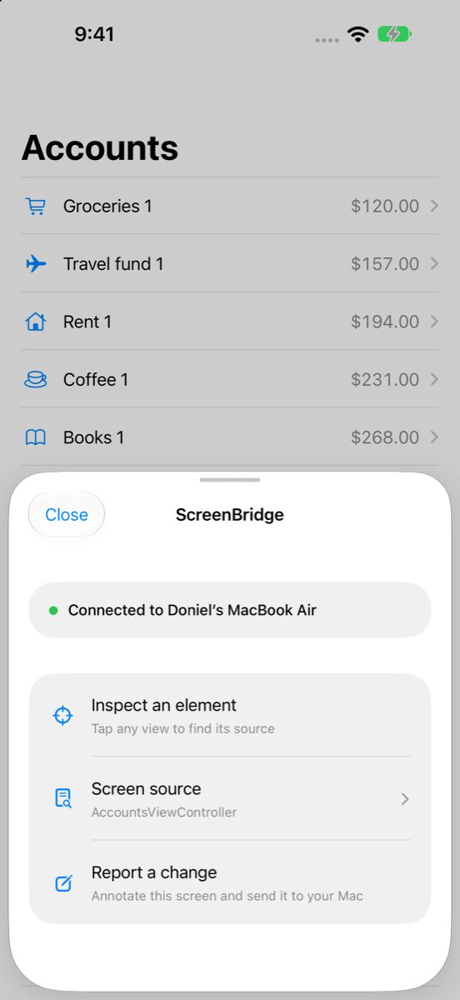
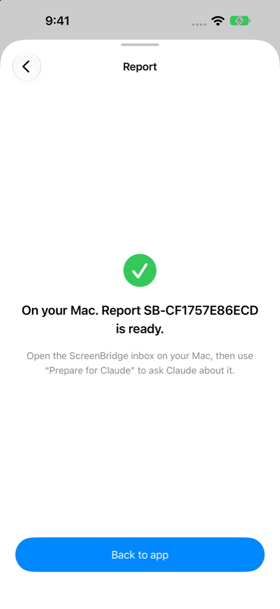

# ScreenBridge

A development-only inspector for iOS apps. Tap a floating button on your iPhone, find the Swift source that registered a screen or element, annotate a screenshot, and send the report to the Mac that built the app. Then ask Claude to read the report, look at the screenshot and open the linked source through a local MCP server.

```
iPhone (Debug build)                         Mac
┌────────────────────────┐   Bonjour +      ┌──────────────────────────────┐
│ ScreenBridge (SPM)     │   TLS-PSK        │ ScreenBridge.app (menu bar)  │
│  • floating inspector  │ ───────────────▶ │  • receiver + report inbox   │
│  • source registry     │  reports, acks,  │  • reveal source in Xcode    │
│  • capture/annotate    │  reveal requests │ screenbridge (build phase)   │
│  • outbox + retry      │                  │ screenbridge-mcp ──▶ Claude  │
└────────────────────────┘                  └──────────────────────────────┘
        ▲ ScreenBridgeConnection.json generated by the Xcode build phase (Debug only)
```

No QR codes, pairing codes or Mac pickers. The build phase writes the receiver's identity and a per-project development key into the Debug app bundle. The app finds that specific Mac over Bonjour and authenticates with TLS‑PSK.

> **Demo app:** [MachangDoniel/ScreenBridgeDemo](https://github.com/MachangDoniel/ScreenBridgeDemo) shows a complete integration (UIKit tabs, navigation, reusable cells, modal, custom containment and SwiftUI).

## Screenshots

<table>
  <tr>
    <td align="center"><br><sub>Floating button (green = connected)</sub></td>
    <td align="center"><br><sub>Inspector sheet</sub></td>
    <td align="center"><br><sub>Element → registered source</sub></td>
  </tr>
  <tr>
    <td align="center"><br><sub>Annotate + opaque redaction</sub></td>
    <td align="center"><br><sub>Acknowledged by the Mac</sub></td>
    <td align="center"><br><sub>SwiftUI <code>.screenBridgeSource</code></sub></td>
  </tr>
</table>

Screens from the [demo app](https://github.com/MachangDoniel/ScreenBridgeDemo) on the iOS simulator.

## Quick start

```bash
./Scripts/install-helper.sh
```

1. Add the package: **File › Add Package Dependencies…** → `https://github.com/MachangDoniel/ScreenBridge.git`, rule **Up to Next Minor Version** from `0.1.0` (0.x minor versions may contain breaking changes). Link only the `ScreenBridge` product to your app target.
2. Add the build phase (one-time). Run `screenbridge print-build-phase` and paste its output into a **Run Script** phase placed last, set **Output Files**, uncheck **Based on dependency analysis**, and set `ENABLE_USER_SCRIPT_SANDBOXING = NO`. Add the two Info.plist keys. See [Docs/Installation.md](Docs/Installation.md).
3. Start ScreenBridge:

   ```swift
   import ScreenBridge

   // AppDelegate.application(_:didFinishLaunchingWithOptions:) or your SwiftUI App.init
   #if DEBUG
   ScreenBridge.start()
   #endif
   ```
4. Register source anchors where it helps:

   ```swift
   override func viewDidLoad() {
       super.viewDidLoad()
       screenBridgeSource(related: [.type(ProfileViewModel.self, role: "viewModel")])
   }
   cell.screenBridgeSource("AccountCell", at: indexPath, in: tableView)   // in cellForRowAt
   Text(title).screenBridgeSource("ProfileHeader")                         // SwiftUI
   ScreenBridge.register(ProfileViewModel.self, role: "viewModel")         // in the type's own file
   ```
5. Run from Xcode, tap the button, choose your tools, then **Send to Claude**. In Claude, ask:
   *“Read ScreenBridge report SB-…, inspect its screenshot and linked source, and propose a fix.”*

## Repository layout

| Path | What |
|---|---|
| `Package.swift`, `Sources/ScreenBridge` | iOS library: inspector UI, source registry, capture, annotation editor, connection/outbox |
| `Sources/ScreenBridgeProtocol` | Versioned report schema, wire framing, annotation renderer with real redaction, log sanitizer |
| `Sources/ScreenBridgeTransport` | Bonjour browser, TLS‑PSK client/listener, outbox with bounded backoff |
| `Mac/Package.swift`, `Mac/Sources/ScreenBridgeMacCore` | Store, credentials, git fingerprints, consistency, path confinement, receiver service, MCP server, CLI |
| `Mac/App` | Menu-bar helper app (xcodegen project) |
| `Scripts/` | `install-helper.sh` (build + install the Mac helper), `test-all.sh` |
| `Docs/` | [Installation](Docs/Installation.md) · [MCP & Claude](Docs/MCP.md) · [Security & release builds](Docs/Security.md) · [Development](Docs/Development.md) · [Troubleshooting](Docs/Troubleshooting.md) |

## Honest boundaries

- A runtime `UIView` does not know which Swift line created it. ScreenBridge shows **registration anchors**: the `#filePath`/`#line` where code registered a screen or element. That's often the definition, not the buggy line. Unregistered related types may get repository-search **inferred candidates**, which are labeled as unverified.
- Adding the SPM dependency doesn't install the Mac app or edit your build phases. Setup is the explicit one-time step above.
- v1 needs both devices on a reachable local network. Xcode's USB debugging channel isn't used.
- Claude Code is the default handoff; Claude Desktop, browser export and Mac inbox are also available. Desktop/Code open a prepared prompt for you to review and send. Browser chats use an exported report and manual image attachments. See [Claude handoff setup](Docs/MCP.md#floating-workspace-and-destinations).

## Debug workspace

Tap the icon for a single row of tools: Select, Pen, Rect, Ellipse, Arrow, Edit annotations, Undo, Redo and More. Drag its grip or any empty panel surface to any corner. Select inspects app views by default. Blue tools draw; orange Edit annotations selects markup for dragging, deleting, and two-finger pinch resizing. **×** hides it while preserving markup. **More** contains Delete all, area selection, colors, redaction, object properties, registered source anchors, source inspection, live app logs and connection status. Send and Claude actions appear beneath the toolbar after a selection or edit. `ScreenBridge.log` prints sanitized messages to the Debug console as well as keeping them in a bounded buffer. Xcode loader and system console messages are not captured. Choose logs, view details, source links and screenshots independently before sending.
